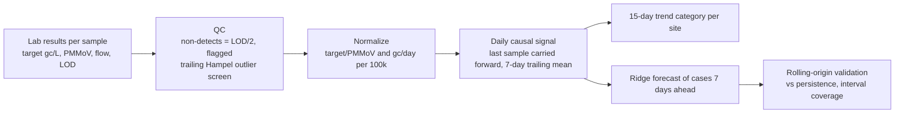

> **Proprietary - All Rights Reserved.** Licensed to Sandeep Grover. No reuse, copying, modification, or distribution without prior written permission. See LICENSE.

# Wastewater Surveillance Modeling (sample)

A small, runnable pipeline for wastewater-based public health surveillance: quality control of lab results, normalization, site-level trend categories, and short-range forecasts of reported cases that are validated out of sample. All data are **synthetic** (three invented sites); no real site, lab or health-department data are included.

## What it does



1. **QC** (`wws/normalize.py`): non-detects are substituted with LOD/2 and kept visible as a flag; a trailing Hampel filter on log10 concentration flags spikes using only earlier samples.
2. **Normalization**: fecal-strength (target / PMMoV, which also cancels dilution and shared lab batch effects) and flow/population (gene copies per day per 100,000 people). Both are log10-transformed.
3. **Trends** (`wws/trend.py`): a least-squares slope over the last 15 days of the smoothed signal, converted to percent change and labelled. Thresholds are parameters to agree with the surveillance team, not a fixed standard.
4. **Forecasts** (`wws/model.py`): closed-form ridge regression predicting log10(1 + 7-day mean cases per 100k) 7 days ahead from the current and lagged wastewater signal plus the current case level.
5. **Validation** (`wws/validate.py`): rolling-origin evaluation with a gap equal to the horizon, a persistence baseline, a cases-only ablation, direction accuracy, and 90% interval coverage with intervals calibrated on out-of-sample residuals.

## Results on the synthetic data (seed 7, 6 folds, 378 forecasts)

| Model | MAE (log10) | Skill vs persistence | Direction accuracy | 90% interval coverage |
|---|---|---|---|---|
| Wastewater, PMMoV-normalized | 0.0897 | 31.3% | 77.0% | 87.8% |
| Wastewater, flow/population-normalized | 0.0916 | 29.8% | 72.2% | 84.4% |
| Cases only (ablation) | 0.1656 | -26.8% | 31.0% | 55.0% |

Interval coverage below 90% means the intervals are still too narrow; on real data this is the first thing to recalibrate before results are shared.

QC summary:

| Site | Samples | Non-detects | Outliers flagged |
|---|---|---|---|
| SITE_A | 129 | 33 | 3 |
| SITE_B | 129 | 32 | 3 |
| SITE_C | 129 | 28 | 1 |

Latest 15-day trends:

| Site | 15-day change | Category |
|---|---|---|
| SITE_A | -81.5% | decreasing |
| SITE_B | -51.8% | decreasing |
| SITE_C | 9.5% | stable |

These numbers describe the synthetic data only. They are regenerated by `python main.py` into `outputs/report.json`.

## Run it

```bash
python -m venv .venv && source .venv/bin/activate
pip install -r requirements.txt
python main.py            # writes outputs/report.json, normalized_samples.csv, forecasts_pmmov.csv
python -m pytest -q       # 9 tests: formulas, outlier screen, trends, no temporal leakage, end to end
```

Tested with Python 3.11, numpy 2.4.2, pandas 2.3.3, pytest 9.0.2.

## Adapting to real data

Replace `wws/simulate.py` with a loader that returns the same two tables: samples (site_id, date, target_gc_per_l, below_lod, pmmov_gc_per_l, flow_mld, population) and cases (site_id, date, cases, population). Site-specific LODs, recovery controls, sewershed population estimates and reporting delays should be agreed with the lab and the epidemiology team before modelling.

Sandeep Grover, PhD
